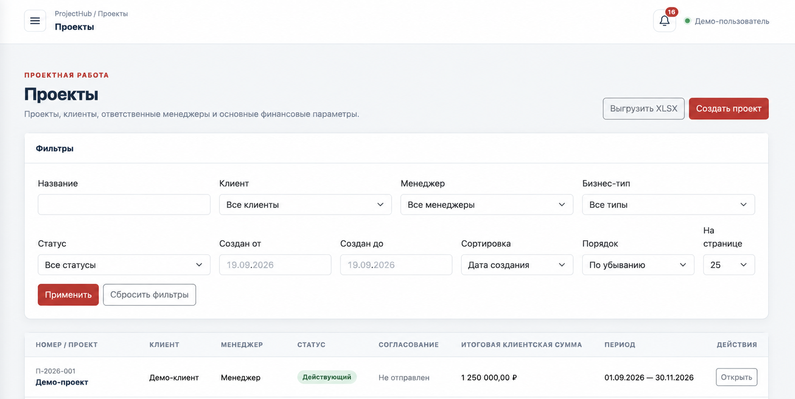
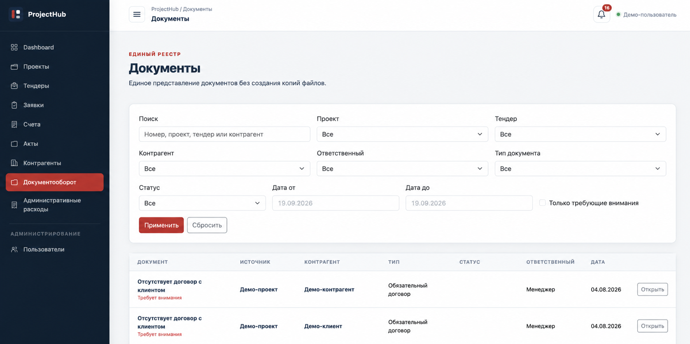

# ProjectHub Demo

Публичная демонстрация одного из ключевых бизнес-процессов проектно-финансовой CRM на Go и PostgreSQL.

> [!IMPORTANT]
> Это самостоятельная clean-room реализация для технического знакомства с проектом. Репозиторий не содержит исходного кода production-системы, данных агентства или его конфиденциальных бизнес-правил. Все названия, суммы и записи в примерах и на скриншотах синтетические.

## О проекте

Основной ProjectHub — закрытая внутренняя CRM, созданная для агентства и используемая в production. Система объединяет проектную работу, финансы и документооборот в одном веб-интерфейсе.

В этом репозитории реализован небольшой, но законченный вертикальный срез: создание проектов и конкурентно-безопасное резервирование их бюджета заявками на оплату. Такой объём позволяет показать архитектуру и работу с транзакциями, не раскрывая код закрытой системы.

Описание полной системы ниже актуализировано на 8 октября 2026 года. Эта дата относится к справочному обзору закрытой CRM и не означает перенос её модулей в demo.

## Функциональность полной системы

Этот раздел описывает закрытую production-систему, а не возможности запускаемого demo API. В публичном репозитории реализован только backend-срез создания проектов и резервирования бюджета заявками; его границы перечислены ниже.

Закрытая CRM покрывает основной рабочий цикл агентства — от планирования проекта или участия в тендере до оплаты обязательств, получения денег от клиента и проверки закрывающих документов.

- **Управленческий dashboard.** После фильтров идут график на всю ширину и девять ключевых показателей, затем парные блоки заявок и задач на сегодня, административных расходов и ближайших платежей. Ниже сгруппированы клиентские счета и риски, документы и закрытие, проекты и тендеры. По умолчанию обзор охватывает два предыдущих месяца, текущий и три следующих; доступны отдельный месяц, квартал, год, всё время и произвольные даты. График использует выбранный период, показывает точные суммы и группирует их по календарным месяцам независимо от часового пояса сервера.
- **Проекты и группы команд.** В карточке ведутся клиент, ответственный менеджер, участники, сроки, бизнес-тип, финансовые параметры, отсрочка клиентского платежа и группа «Инфлюенс» либо «Ивент». Группа определяет рабочий контур тимлида. Проект проходит планирование, активацию, выполнение и окончательное закрытие; переходы зависят от прав, финансовой и документарной готовности. Руководитель может удалить проект только на этапе планирования.
- **Рабочие сметы и финансирование.** Смета содержит статьи расходов, внутренние налоги и комиссии, клиентскую стоимость и автоматический либо разрешённый руководителем ручной режим УСН и НДС. Gross-up применяется для УСН, НДС начисляется обычным способом. Стоимость финансирования автоматически учитывает заявки с налогами и отсрочку платежа клиента и вычитается из ожидаемой маржи. Деньги хранятся целыми копейками; изменение финансовых данных сбрасывает устаревшее согласование, а при конфликте редактирования форма сохраняет введённые значения для повторной проверки.
- **Тендеры.** Тендеры ведутся независимо от проектов: с отдельными статусами, бюджетом, расходами, рентабельностью, ответственными, заявками и документами.
- **Заявки на оплату.** Заявку можно создать по примерной сумме до подготовки документов и временно оставить подрядчика на уточнении. Обычное подтверждение и оплата требуют подписанного договора, подписанного приложения/ДС либо отметки «Не предполагается» и прикреплённого счёта. В карточке виден актуальный способ подписания каждого связанного документа — «ЭДО» или «Оригиналы». Руководитель и тимлид подтверждают заявки и возвращают их на доработку или согласование; руководитель и бухгалтер фиксируют оплату. Исключение для оплаты без полного комплекта данных доступно только руководителю. Ошибочную неподтверждённую заявку можно полностью удалить с освобождением резерва; подтверждённые и оплаченные защищены от удаления.
- **Клиентские счета.** Для проектов формируется план поступлений со статусами «Запланирован», «Выставлен» и «Оплачен». Система отслеживает просрочки и не позволяет уменьшить стоимость проекта ниже уже полученной оплаты.
- **Контрагенты.** Контрагент имеет одну роль — клиент или подрядчик; справочник поддерживает поиск по названию и ИНН, а категория подрядчика видна в связанных договорах. Из карточки подрядчика можно перейти к его заявкам и оплатам, из карточки клиента — к связанным проектам.
- **Договоры, приложения и подписание.** К договору добавляются самостоятельные ветки приложений и дополнительных соглашений с версиями и согласованием. Подписание оригиналов объединяет загрузку скана и подтверждение в одно действие и фиксирует конкретную подписанную версию; для ЭДО скан не нужен, отметку может поставить руководитель или ответственный менеджер. Изменение способа подписания договора применяется к ещё не подписанным связанным документам; уже подписанные ветки защищают историю. Руководитель редактирует доступные по статусу реквизиты, ответственный менеджер после отправки на согласование — только способ подписания. Неактуальные версии и неиспользуемые ветки можно удалить с учётом связей; договор с приложениями не удаляется. Даты при загрузке и редактировании документов необязательны, исходные имена и расширения файлов сохраняются.
- **Акты и закрывающие документы.** Входящие и исходящие акты связываются со счетами и заявками и формируют документарное покрытие проекта. Из оплаченной заявки акт добавляется через упрощённую форму с файлом и полной суммой. Один акт может закрывать несколько оплат, поэтому его сумма может превышать сумму отдельной заявки; покрытие учитывается в пределах распределённых сумм. Только подписанные исходящие и принятые входящие акты участвуют в закрытии.
- **Уведомления.** Центр уведомлений собирает актуальные задачи с учётом рабочего контура пользователя. В задачах по договорам сразу видны контрагент и связанный проект или тендер; возврат документов с правками сопровождается уведомлением. Предупреждение об окончании договора можно принять и скрыть для себя. Препятствия окончательному закрытию проекта показываются начиная с даты окончания периода его проведения, а завершённые задачи исчезают из блока внимания. Поддерживаются массовая отметка прочтения и еженедельная сводка по заявкам на согласовании.
- **Административные расходы.** Руководитель с отдельным правом ведёт разовые заявки и регулярные правила, категории, плановые и фактические суммы. Ближайший черновик создаётся сразу, дальнейшие — автоматически; выходная дата переносится на следующий рабочий день по правилу субботы и воскресенья. Регулярное правило можно удалить без удаления уже сформированной финансовой истории. Расход можно вернуть из подтверждённого статуса в черновик, а неиспользуемую категорию — удалить навсегда.
- **Роли и безопасность.** Разграничены руководитель, менеджер, тимлид и бухгалтер. Тимлид работает с проектами своей группы и может подтверждать и возвращать заявки, переводить проекты в действующие и выполненные; подтверждение ручного режима налогов остаётся за руководителем. Бухгалтер работает с подтверждёнными и оплаченными заявками и контрагентами, фиксирует оплату и контролирует закрытие, но не получает доступ к проектам, тендерам и сметам. Только руководитель создаёт пользователей и меняет роли, включая повышение менеджера до тимлида с выбором группы. Права проверяются на backend; используются серверные сессии, CSRF-защита, защищённое хранение файлов и отзыв сессий при изменении учётной записи.
- **Реестры и отчётность.** Основные реестры поддерживают фильтры, сортировку и XLSX-выгрузку с учётом прав. В заявках есть поиск по номеру и клиенту, несколько выбранных статусов, поиск внутри длинных списков и общая сумма всей отфильтрованной выборки независимо от страницы. Фильтры сохраняются при переходах, список и выгрузка используют одну актуальную выборку. Маржинальность dashboard рассчитывается от клиентской суммы до УСН и НДС с учётом стоимости финансирования.

## Что демонстрирует репозиторий

- разделение приложения на HTTP-, application-, domain- и persistence-слои;
- REST API на стандартном `net/http`;
- PostgreSQL-репозиторий на `pgx`;
- хранение денег целыми копейками без `float`;
- ограничения целостности на уровне схемы базы данных;
- транзакционное резервирование бюджета;
- блокировку строки проекта через `SELECT ... FOR UPDATE`;
- защиту от превышения бюджета при конкурентных запросах;
- строгий разбор JSON и доменные HTTP-ошибки;
- структурированное логирование, healthcheck и корректное завершение сервера;
- unit- и HTTP-тесты, race detector и GitHub Actions;
- воспроизводимый запуск через Docker Compose.

## Интерфейс полной системы

Ниже показаны обезличенные экраны закрытой CRM. Они иллюстрируют интерфейс и предметную область полной системы; сам demo-репозиторий содержит только описанный backend-срез.

### Реестр проектов



### Единый реестр документов



На экране видны фильтры по проектам, тендерам, контрагентам, ответственным, типам и статусам документов.

На изображениях нет реальных ФИО, названий компаний, ИНН, договоров или финансовых показателей агентства.

## Бизнес-сценарий demo

У проекта есть утверждённый бюджет. Пользователь создаёт заявку на оплату, после чего её сумма сразу резервируется. Несколько одновременных запросов не могут зарезервировать больше доступного остатка: проверка и изменение выполняются внутри одной PostgreSQL-транзакции.

```text
HTTP-запрос
    │
    ▼
Handler → Application service → Repository → PostgreSQL
                                          │
                                          ├─ блокировка проекта
                                          ├─ проверка остатка
                                          ├─ создание заявки
                                          ├─ резервирование суммы
                                          └─ commit
```

Деньги передаются и хранятся в копейках. Например, `2500000` означает `25 000,00 ₽`.

## Технологии

- Go 1.25.13;
- PostgreSQL 17;
- `pgx/v5` и `pgxpool`;
- стандартный `net/http`;
- Docker и Docker Compose;
- GitHub Actions.

## Быстрый запуск

Потребуются Docker и Docker Compose.

```bash
docker compose up --build
```

API будет доступно по адресу <http://localhost:8080>.

Если порт `8080` уже занят:

```bash
HOST_PORT=18082 docker compose up --build
```

Проверка готовности:

```bash
curl http://localhost:8080/healthz
```

## Примеры запросов

Создать проект с бюджетом `150 000,00 ₽`:

```bash
curl -i http://localhost:8080/api/v1/projects \
  -H 'Content-Type: application/json' \
  -d '{
    "name": "Демо-проект",
    "client": "Демо-клиент",
    "budget_kopecks": 15000000
  }'
```

Создать заявку на `25 000,00 ₽`:

```bash
curl -i http://localhost:8080/api/v1/projects/1/payment-requests \
  -H 'Content-Type: application/json' \
  -d '{
    "purpose": "Услуги производства",
    "amount_kopecks": 2500000
  }'
```

Получить список проектов и зарезервированные суммы:

```bash
curl http://localhost:8080/api/v1/projects
```

## API

| Метод | Маршрут | Назначение |
|---|---|---|
| `GET` | `/healthz` | проверка доступности PostgreSQL |
| `GET` | `/api/v1/projects` | список проектов |
| `POST` | `/api/v1/projects` | создание проекта |
| `POST` | `/api/v1/projects/{id}/payment-requests` | резервирование бюджета и создание заявки |

## Конкурентная безопасность

Создание заявки выполняется в одной транзакции:

1. Строка проекта блокируется `SELECT ... FOR UPDATE`.
2. Рассчитывается доступный остаток `budget_kopecks - reserved_kopecks`.
3. При нехватке средств возвращается доменная ошибка `project budget exceeded`.
4. Создаётся заявка на оплату.
5. Зарезервированная сумма проекта увеличивается.
6. Транзакция фиксируется.

В Docker-проверке два одновременных запроса по `7 000` копеек к бюджету `10 000` дали ожидаемый результат: один запрос получил HTTP `201`, второй — HTTP `409`. Итоговый резерв составил `7 000` копеек, переполнение не произошло.

## Тестирование и качество

```bash
go test -race ./...
go vet ./...
staticcheck ./...
golangci-lint run ./...
govulncheck ./...
```

Локально и в GitHub Actions проходят unit- и HTTP-тесты, `go vet` и race detector. `govulncheck` не находит известных уязвимостей в используемой конфигурации.

## Структура репозитория

```text
cmd/api/                    точка запуска HTTP-приложения
internal/app/               сценарии использования и валидация
internal/domain/            доменные модели и ошибки
internal/httpapi/           HTTP-транспорт
internal/store/postgres/    PostgreSQL-репозиторий и миграция
assets/screenshots/         обезличенные изображения интерфейса
.github/workflows/          непрерывная интеграция
```

Основное направление зависимостей:

```text
HTTP handler → application service → repository → PostgreSQL
```

## Границы demo

Репозиторий намеренно не воспроизводит всю закрытую CRM. В него не включены авторизация, SSR-интерфейс, тендеры, полная смета, клиентские счета, акты, договоры, файлы, уведомления и процессы согласования. Эти модули перечислены только как контекст production-системы и не заявляются как функциональность данного demo.

## Лицензия

MIT. Репозиторий не содержит production-код закрытой системы, персональные данные или конфиденциальные материалы агентства.
