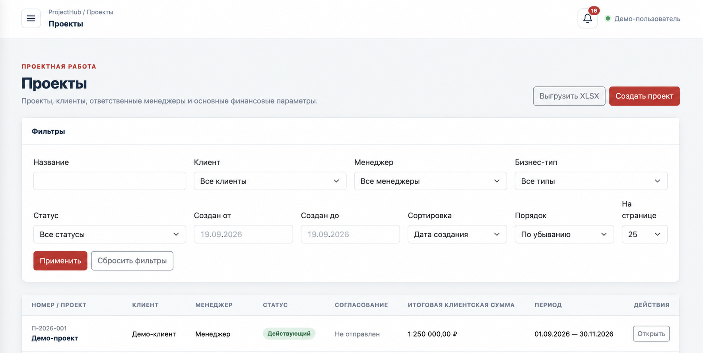
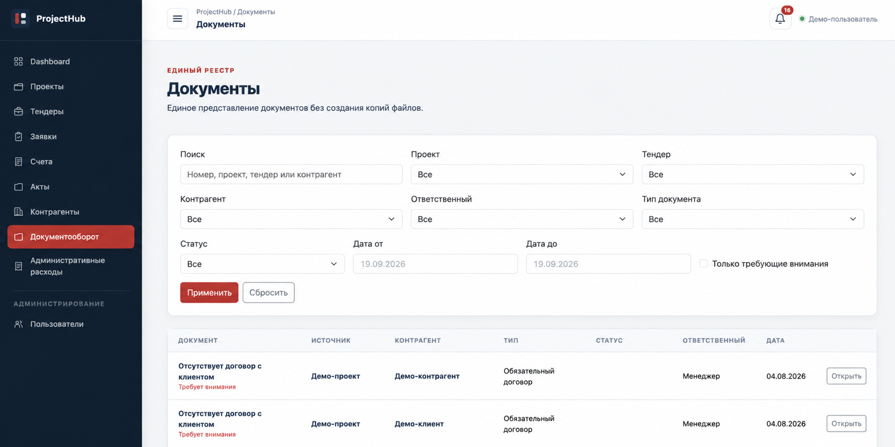

# ProjectHub: обзор полной CRM

Актуально на **10 ноября 2026 года**.

ProjectHub — закрытая внутренняя проектно-финансовая CRM агентства. Она объединяет планирование проектов и тендеров, работу команд, платежи, клиентские поступления и договорный документооборот.

Этот документ даёт предметный контекст. **Публичное [demo](../README.md) реализует только создание проектов и транзакционный резерв бюджета.** Описанные ниже роли, экраны и бизнес-процессы в его API отсутствуют.

## Проекты и команды

В проекте ведутся клиент, ответственный менеджер, участники, сроки, бизнес-тип, финансовые параметры и отсрочка клиентского платежа. Направления — «Инфлюенс» и «Спец. проект»; направление задаёт рабочий контур тимлида.

Проект проходит планирование, активацию, выполнение и окончательное закрытие. Переходы учитывают права, финансовую и документарную готовность. При отправке проекта на активацию обязателен выбор руководителя или тимлида своей группы. Руководитель может удалить проект на этапе планирования.

Тендеры ведутся отдельно: со статусами, бюджетом, расходами, рентабельностью, ответственными, заявками и документами.

## Сметы, финансирование и резерв

Рабочая смета содержит статьи расходов, внутренние налоги и комиссии, клиентскую стоимость. Для УСН применяется gross-up, НДС начисляется обычным способом; ручной налоговый режим требует разрешения руководителя. Деньги учитываются в целых копейках.

Стоимость финансирования рассчитывается по формуле:

```text
полный плановый внутренний расход сметы × 27% × дни отсрочки / 365
```

База — плановый расход всей сметы, а не сумма фактических заявок. Стоимость финансирования уменьшает ожидаемую маржу; при нулевой отсрочке она равна нулю.

В планировании статьи можно исправлять последовательно при временном расхождении со счетами. Активация требует согласованных итогов. Редактирование не позволяет нарушить уже занятый заявками резерв. Изменения финансовых данных сбрасывают устаревшее согласование; при конфликте редактирования введённые значения сохраняются для повторной проверки.

## Заявки и НДС подрядчиков

Предварительная заявка может содержать приблизительную сумму, ещё не уточнённого подрядчика или НДС. Менеджер вводит фактическую сумму конкретного платежа; процент предоплаты носит информационный характер и не рассчитывает платёж автоматически. Подрядчика можно найти по названию и выбрать из справочника.

Обычное подтверждение и оплата требуют подписанного договора, подписанного приложения/ДС либо отметки «Не предполагается» и прикреплённого счёта. Исключение для оплаты без полного комплекта данных доступно руководителю. Руководитель и тимлид подтверждают и возвращают заявки в пределах своих прав; руководитель и бухгалтер фиксируют оплату.

Правила НДС распространяются на проектные, тендерные и административные заявки. Поддерживаются ставки 0%, 5%, 7%, 22%, отсутствие НДС и отдельное состояние «НДС не уточнён»; сумма НДС может вводиться вручную. Неизвестный НДС не считается подтверждённым нулевым.

| Наш плательщик и НДС | Расход для бюджета |
| --- | --- |
| ООО, ставка 22% | Фактический платёж за вычетом содержащегося в нём НДС |
| ООО, остальные ставки или без НДС | Полный платёж |
| ИП, прочий или неуточнённый плательщик | Полный платёж |
| Неуточнённый НДС | Полный платёж |

ООО и ИП здесь обозначают **нашего плательщика**, а не форму подрядчика. Платёж, НДС платежа и бюджетный расход учитываются раздельно: резерв использует бюджетный расход, денежные суммы и покрытие актами — полный платёж. Старые заявки автоматически не пересчитываются; уточнение выполняется явно с историей изменений.

Несогласованные заявки может удалять менеджер в пределах своих заявок, а тимлид — своей группы, с освобождением резерва. Подтверждённые и оплаченные заявки защищены от удаления.

Руководитель может исправлять оплаченную заявку, включая сумму, подрядчика и НДС, в том числе в закрытом проекте. Исправление сохраняет историю и прежний итог закрытия через финансовые ревизии, не создаёт повторный платёж и не открывает проект менеджерам. Принятые акты автоматически не изменяются. Уменьшение платежа ниже покрытия актами требует сначала явно исправить акт или распределение; смена подрядчика учитывает связанные документы.

## Клиентские поступления и контрагенты

Клиентские счета формируют план поступлений со статусами «Запланирован», «Выставлен» и «Оплачен». Система отслеживает просрочки и не позволяет уменьшить стоимость проекта ниже уже полученной оплаты.

Контрагент имеет роль клиента либо подрядчика. Доступны поиск по названию и ИНН, категории подрядчиков и переходы к связанным проектам, заявкам и оплатам.

## Договоры, версии и подписание

Договоры имеют самостоятельные ветки приложений и дополнительных соглашений, версии и историю согласования. У договоров и актов задаётся способ подписания — «ЭДО» или «Оригиналы». Он наследуется связанными документами с допустимыми правками; изменение способа подписания не переписывает историю уже подписанных документов.

Для оригиналов загрузка скана и подтверждение фиксируют конкретную подписанную версию. Для ЭДО скан не требуется; применяются права на отметку подписания. Даты документов необязательны, исходные имена и расширения файлов сохраняются.

Каждая ветка доступна её автору, тимлиду соответствующего направления и руководителю. Связь с проектом или заявкой сама по себе не открывает чужую ветку. Направление берётся из проекта, а при отсутствии такой привязки выбирается явно. Можно загрузить исправленный документ и вернуть согласованную ветку на согласование. Руководитель также может отменить ошибочное согласование ещё не подписанного документа с сохранением версий, файлов, связей и записи в истории. При согласовании доступны комментарий и новый файл; подписание остаётся отдельным действием.

Менеджер запрашивает удаление договора, ветки или версии у тимлида направления; руководитель выступает резервным адресатом. Удаление учитывает связи и используемые документы: запрос не обходит эти ограничения.

## Акты и закрытие

Входящие и исходящие акты связываются со счетами и заявками. Из оплаченной заявки акт можно добавить через форму с файлом и полной суммой. Один акт может покрывать несколько оплат; покрытие ограничено распределёнными суммами. В окончательном закрытии участвуют подписанные исходящие и принятые входящие акты.

Способ подписания акта учитывается отдельно от факта его принятия или подписания. Исправление заявки не подменяет файлы, суммы или контрагента в уже принятых актах.

## Управление, отчётность и административные расходы

Dashboard объединяет финансовый график, ключевые показатели, заявки и задачи, административные расходы, платежи, клиентские счета, документы и риски закрытия. Доступны календарные и произвольные периоды. Маржинальность рассчитывается от клиентской суммы до УСН и НДС с учётом финансирования.

Реестры поддерживают фильтры, сортировку и XLSX с учётом прав. Список и выгрузка используют одну выборку, суммы учитывают всю выборку, а не только страницу. Отдельный XLSX-отчёт НДС строится по **фактической дате оплаты**. Он показывает исправленные данные, сохраняя проект, к которому платёж относился на момент оплаты; перенос заявки не переписывает эту историю.

Административные расходы включают разовые заявки, регулярные правила, категории и плановые/фактические суммы. Правило формирует ближайший черновик, далее расходы создаются автоматически; суббота и воскресенье переносятся на следующий рабочий день. Удаление правила сохраняет созданную финансовую историю.

## Доступ и уведомления

Разделены роли руководителя, менеджера, тимлида и бухгалтера. Тимлид работает в своём направлении; бухгалтер — с подтверждёнными и оплаченными заявками и контрагентами без доступа к проектам, тендерам и сметам. Только руководитель управляет пользователями и ролями. Backend проверяет права; используются серверные сессии, CSRF-защита и контролируемый доступ к файлам.

Внутренний центр уведомлений показывает актуальные задачи по рабочему контуру, включая согласование, возврат документов и препятствия закрытию. Доступны отметки прочтения и сводка по заявкам на согласовании.

**S3, отдельный мониторинг и email/push-уведомления отложены и не реализованы.** Они не входят в demo и не заявляются как готовые возможности полной CRM.

## Иллюстрации полной системы

Экраны ниже иллюстрируют закрытую CRM и не являются интерфейсом запускаемого demo. Подписи и оформление на иллюстрациях могут отличаться от текущего обзора.

### Реестр проектов



### Реестр документов



[Вернуться к запуску demo](../README.md)
